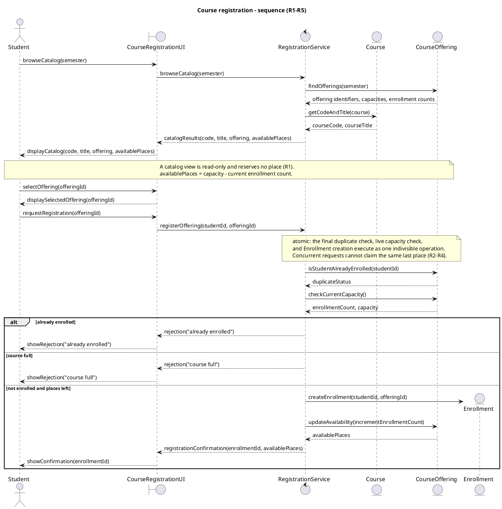
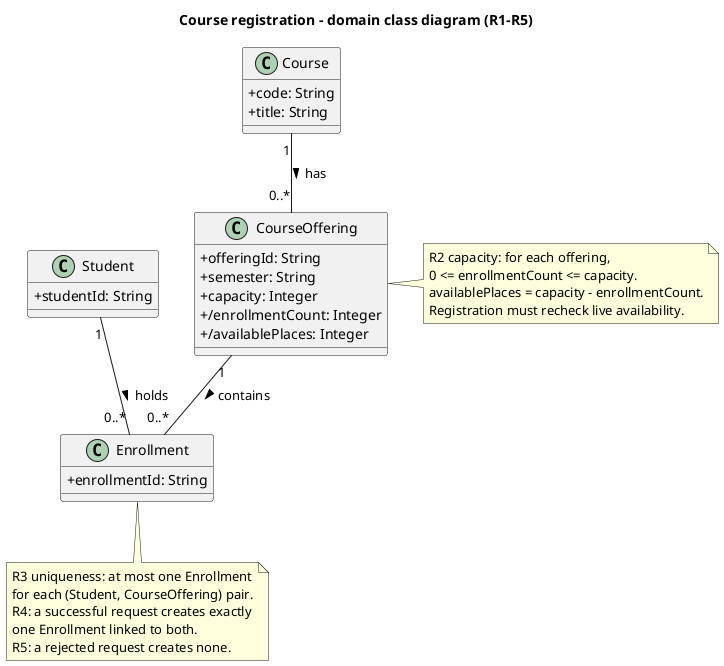

# SIS #02 — AI-Assisted UML Modeling: University Course Registration
<!--

  This is the only file you write your report in. README.md tells you what goes where.


  Rules the checker relies on:

  - Do not delete, rename or renumber the ## headings, the ### headings, or the **Label:** words.

  - Replace every "(write here)" and "(paste here)". None may be left when you submit.

  - Comments like this one are ignored by the checker and the word counter. Delete them or leave them.

-->


## 1. Scope and assumptions
**Scope:**

The system allows signed-in students to browse course offerings for a semester, view available places, register for a specific offering, and receive a confirmation or rejection. The system checks capacity and duplicate enrollments. Payments, prerequisites, timetable clashes, waiting lists, and cancellation are out of scope.


**Assumptions:**


1. Students are already signed in before requesting registration.

2. Available places are calculated using the offering capacity and current enrollment count.


## 2. User stories and acceptance criteria
<!-- Your APPROVED requirements: Prompt A's draft after your review. Keep the IDs, the three

     story headings and the bullet shape. Every criterion names the rule(s) it maps to,

     e.g. (R2, R4). Two criteria per story. Nothing out of scope.

     Format of a criterion, on one bullet:

     - **AC-03** (R2, R4): Given ..., When ..., Then ... -->


### US-01 — Browse offerings
**US-01:** As a student, I want to browse the course catalog for a selected semester so that I can see available course offerings and their remaining places.


- **AC-01** (R1): Given a semester contains course offerings with defined capacities and enrollment counts, When the student browses the catalog, Then the system displays the course code, title, offering, semester, and available places.

- **AC-02** (R1, R2): Given an offering has available places, When the student views the catalog without registering, Then no Enrollment is created, no place is reserved, and the enrollment count remains unchanged.


### US-02 — Register for an offering
**US-02:** As a student, I want to register for a specific course offering so that I can obtain a place when registration is permitted.


- **AC-03** (R2, R3, R4): Given an offering has available places and the student is not already enrolled, When the student requests registration, Then the system atomically rechecks capacity and duplicate enrollment, creates exactly one Enrollment linking the student and offering, updates availability, and returns a confirmation.

- **AC-04** (R2, R3, R4): Given an offering has capacity 2 and enrollment count 1, and the requesting student is not enrolled, When the student registers while the last place is available, Then the system atomically performs final checks, creates one Enrollment, increases the count to 2, updates available places to 0, and confirms registration.


### US-03 — Receive a clear rejection
**US-03:** As a student, I want to receive a clear rejection reason when registration is not permitted so that I understand why my request was unsuccessful.


- **AC-05** (R2, R5): Given the catalog previously showed an available place but the current offering is full and the student is not already enrolled, When the student requests registration, Then the system rejects the request with "course full", creates no Enrollment, and leaves the enrollment count unchanged.

- **AC-06** (R3, R5): Given the student already has an Enrollment for the selected offering, When the student requests registration again, Then the system rejects the request with "already enrolled", creates no additional Enrollment, and leaves the enrollment count unchanged.


## 3. Sequence diagram
<!-- The FINAL diagram, rendered. Change .png to .svg if that is what you exported. -->


**Participants:** Student is the actor who browses the catalog and requests registration. CourseRegistrationUI receives the student's actions and displays results. RegistrationService coordinates catalog browsing and registration. Course provides the course code and title. CourseOffering provides the offerings, enrollment information and current capacity. Enrollment represents the new registration record created on success.


**Atomic operation:** The registration operation includes isStudentAlreadyEnrolled(studentId), checkCurrentCapacity(), and createEnrollment(studentId, offeringId). These steps must be atomic to prevent two competing requests from taking the same final available place. A catalog view only reads availability and does not create an Enrollment or reserve capacity.


**Where the Enrollment is created:** In the "else not enrolled and places left" branch, RegistrationService sends createEnrollment(studentId, offeringId) to the newly created Enrollment lifeline. This produces one Enrollment instance linked to the Student and CourseOffering classes shown in section 4. After creation, getDerivedAvailablePlaces() retrieves updated availability before confirmation.


**Technical lifelines:** CourseRegistrationUI and RegistrationService are technical lifelines that do not appear in the domain class diagram. CourseRegistrationUI represents the interface, while RegistrationService coordinates application behavior. They belong to the interaction model rather than the core domain model, so their absence from the class diagram is appropriate.


## 4. Class diagram


| Association | Read left to right | Read right to left |

| --- | --- | --- |

| Course "1" -- "0..*" CourseOffering | One Course can have zero or many CourseOfferings. | Every CourseOffering belongs to exactly one Course. |

| Student "1" -- "0..*" Enrollment | One Student can have zero or many Enrollments. | Every Enrollment belongs to exactly one Student. |

| CourseOffering "1" -- "0..*" Enrollment | One CourseOffering can have zero or many Enrollments, subject to its capacity. | Every Enrollment belongs to exactly one CourseOffering. |


**How an Enrollment links a student to an offering:** Each Enrollment links exactly one Student to exactly one CourseOffering through two associations. Every Enrollment has a unique enrollmentId and represents one successful registration.


**Capacity constraint:** For each CourseOffering, 0 <= enrollmentCount <= capacity. The enrollmentCount is derived from the number of linked Enrollments. The availablePlaces value is calculated as capacity - enrollmentCount. Multiplicity alone cannot express capacity because different offerings may have different capacity limits.


**Uniqueness constraint:** A Student can have at most one Enrollment for the same CourseOffering. This constraint prevents duplicate registrations. UML multiplicities alone cannot guarantee uniqueness for each Student-CourseOffering pair, so the rule is written explicitly in a note.


## 5. Traceability
| Rule and criterion | Model evidence | Validation case |

| --- | --- | --- |

| R1 + AC-01, AC-02 | browseCatalog(semester), findOfferings(semester), loop for each offering, catalogResults(code, title, offering, semester, availablePlaces), and displayCatalog(). The catalog is read-only. | Additional catalog check: all required fields are displayed, and browsing creates no Enrollment. |

| R2 + AC-02, AC-03, AC-04, AC-05 | checkCurrentCapacity(), atomic-operation note, CourseOffering capacity constraint, and derived availablePlaces. | T1, T2, T3 |

| R3 + AC-03, AC-04, AC-06 | isStudentAlreadyEnrolled(studentId), alt already enrolled, and the Enrollment uniqueness constraint. | T4 |

| R4 + AC-03, AC-04 | createEnrollment(studentId, offeringId), getDerivedAvailablePlaces(), registrationConfirmation(), and Enrollment associations with Student and CourseOffering. | T1, T2 |

| R5 + AC-05, AC-06 | The course full and already enrolled rejection branches create no Enrollment and leave the enrollment count unchanged. | T3, T4 |


## 6. Walkthroughs
| Case | Observed path and state change | Judgment and evidence |

| --- | --- | --- |

| T1. Available | Capacity = 2, enrollmentCount = 0. A new student selects an offering and sends requestRegistration(offeringId). UI calls registerOffering(studentId, offeringId). Service checks isStudentAlreadyEnrolled(studentId) and checkCurrentCapacity(). The student is not enrolled and two places are available. The success branch creates exactly one Enrollment linked to the student and offering. The derived enrollmentCount changes from 0 to 1, and availablePlaces becomes 1. The system returns registrationConfirmation(). | Pass — The "else not enrolled and places left" branch contains createEnrollment(), getDerivedAvailablePlaces(), and registrationConfirmation(). |

| T2. Last place | Capacity = 2, enrollmentCount = 1. A new student requests registration. Service checks duplicate status and current capacity. Since the student is not enrolled and one place remains, the success branch creates exactly one Enrollment. The derived enrollmentCount changes from 1 to 2, and availablePlaces becomes 0. The student receives confirmation. | Pass — The atomic-operation note and the successful createEnrollment() branch ensure the last place is allocated without exceeding capacity. |

| T3. Full | The catalog previously displayed one available place, but the current enrollmentCount is 2 and capacity is 2. The student requests registration. Service calls isStudentAlreadyEnrolled(studentId) and checkCurrentCapacity(). The current offering is full, so the "else course full" branch returns rejection("course full"). No Enrollment is created. The enrollmentCount remains 2 and availablePlaces remains 0. | Pass — checkCurrentCapacity() and the "else course full" branch reject registration without changing enrollment state. |

| T4. Duplicate | Capacity = 2, enrollmentCount = 1. The already-enrolled student requests registration for the same offering again. Service calls isStudentAlreadyEnrolled(studentId), receives duplicateStatus, and checks current capacity. The "alt already enrolled" branch returns rejection("already enrolled"). No additional Enrollment is created. The enrollmentCount remains 1 and availablePlaces remains 1. | Pass — isStudentAlreadyEnrolled() and the "alt already enrolled" branch prevent duplicate registration. |


## 7. Review decisions
<!-- At least three substantive decisions about Prompt C's critique or your own inspection.

     Decision: accepted / rejected / modified — and what you did. Reason: why, in a full

     sentence. Rule: R1–R5. Do not invent an error to fill the table; a justified rejection

     of advice counts. -->

| AI suggestion or model element | Decision | Reason | Rule |

| --- | --- | --- | --- |

| Missing semester in catalog output | Accepted — add semester | The catalog must display the semester together with the course code, title, offering and available places to satisfy AC-01. | R1 |

| Multiple offering results are unclear | Accepted — add loop | The sequence diagram should process each offering separately to ensure every offering has the correct course code and title. | R1 |

| Direct update of derived enrollment count | Accepted — recalculate availability | The enrollment count is derived from existing enrollments, so incrementing it directly may produce inconsistent values or double counting. | R2, R4 |

**Known checker failures:**

| Checker ID | Explanation |
| --- | --- |
| A1 | The original Appendix A scope was written on lines after the `**Scope:**` label. The checker reads only the label line and therefore reports an empty scope. I have preserved the pre-AI wording rather than silently rewriting the frozen baseline. I will declare A1 in `submission.yml` under `known_fails`. |

## 8. Modeling explanation
The domain class diagram describes the main information managed by the university course registration system. It contains four required classes: Student, Course, CourseOffering, and Enrollment. The Course class stores the course code and title, while CourseOffering represents a specific offering in a semester. This distinction is important because one course can have multiple offerings. Each Enrollment connects one Student to one CourseOffering.


I used multiplicities to explain the relationships between the classes. However, multiplicities alone cannot enforce the maximum capacity or prevent duplicate registrations. Therefore, the class diagram includes separate notes for capacity and uniqueness constraints. I also modeled enrollmentCount and availablePlaces as derived attributes because these values depend on existing Enrollments.


The sequence diagram describes how the system behaves when a student browses offerings and requests registration. It shows messages between Student, CourseRegistrationUI, RegistrationService, Course, and CourseOffering. A loop processes every offering in the catalog. During registration, the system checks duplicate enrollment and current capacity before creating an Enrollment.


The atomic-operation note is important because concurrent requests must not exceed capacity. Successful registration creates exactly one Enrollment and returns confirmation. Rejected requests do not change enrollment data.


Both diagrams complement each other. The class diagram explains the structure and relationships, while the sequence diagram illustrates the order of interactions and decisions. An activity diagram could also help explain the overall registration workflow by showing its decision paths, successful outcomes, and rejection outcomes.


## 9. Reflection
AI helped me understand how to transform requirements into UML diagrams. It generated the initial user stories, acceptance criteria, and PlantUML code. However, the first versions were not completely correct, so reviewing the results was an important part of the assignment.


One important decision was to accept the correction of the derived enrollment count. The original sequence directly increased enrollmentCount, although the class diagram defined it as a derived attribute. I preferred creating an Enrollment and calculating availability from the linked records because this keeps the diagrams consistent.


I also learned the difference between original and final UML files while working in VS Code. Saving the diagrams as PlantUML source files and exporting them as PNG images helped me understand the submission structure.


One remaining limitation is that UML diagrams only describe the expected behavior. They do not implement concurrency protection. The atomic operation must still be enforced in a real system. This assignment showed me that AI-generated diagrams require human review and verification against the requirements.


## 10. Appendix A — Before AI
<!-- Written BEFORE you run Prompt A, committed and pushed in your first commit, and never

     edited afterwards. This is what you paste into Prompt A as "My initial assumptions". -->


**Scope:** The system allows students to course catalog and available places, select a specific course offering, and receive registration confirmation or rejection. The system checks available capacity and duplicate enrollment.

**Initial assumptions:**


1. I assume that students are already signed in 

   before requesting registration.


2. I assume that available places are calculated

   using offering capacity and current enrollment count.


## 11. Appendix B — AI exchanges
<!-- Complete prompts and complete responses, as text — never screenshots. Paste each inside

     the ~~~~ block that follows its label: AI responses contain \`\`\` PlantUML blocks, and

     ~~~~ keeps them from breaking this file. Prompts B and C: the prompt text first, then

     the material it refers to ("below", "these two") pasted under it, in the same block.

     You may add B5, B6 … after B4 if you ran more. -->


### B1 — Requirements (Prompt A)
- **Tool:** ChatGpt

- **Model:** GPT-6

- **Date:** 2026-10-18

- **Purpose:** draft 3 user stories and 6 acceptance criteria


<!-- Model: the exact model with its version, as the tool shows it (e.g. "GPT-5 Thinking",

     "Claude Sonnet 4.5"). If the tool does not show it, write: not displayed

     Date: YYYY-MM-DD -->


**Prompt:**


~~~~text


Act as a requirements analyst. Use only this course registration scenario and rules R1–R5: A student browses an electronic course catalog, chooses a course offering and requests registration. Each offering has a limited number of places.


A Course describes a subject. A CourseOffering is one scheduled section in one semester. Registration always targets a specific offering.


Assume that the student is signed in, the selected offering exists, and its capacity is a positive whole number.


Exclude payments, prerequisites, timetable clashes, waiting lists and cancellation. Use fictional students and courses.


R1. Catalog: Show the course code, title, offering and available places for one semester.

R2. Capacity: Recheck current availability when registering. Enrollment must never exceed the offering's capacity.

R3. Duplicates: A student may have at most one enrollment in the same offering. Reject a repeat request.

R4. Success: Create exactly one Enrollment linking the student and offering, update availability and return a confirmation.

R5. Rejection: Explain "course full" or "already enrolled". Create no enrollment and leave the enrollment count unchanged.


A catalog view does not reserve a place. Model the final checks and enrollment creation as one atomic operation so competing requests cannot take the same last place. A note describing the atomic operation is sufficient; database implementation is outside this assignment.


My initial assumptions are 1. I assume that students are already signed in before requesting registration. 2. I assume that available places are calculated using offering capacity and current enrollment count.

Draft 3 user stories and 2 Given / When / Then acceptance criteria for each. Use IDs US-01 to US-03 and AC-01 to AC-06. Map each criterion to rule IDs.

Cover normal and rejection behavior. List uncertainty separately. Do not add excluded features or invent university policies.

~~~~


**Response:**


~~~~text


# Prompt A — Requirements Analysis


## 1. User Stories


### US-01 — View Course Catalog


**User Story:**  

As a student, I want to browse the course catalog for a selected semester so that I can see available course offerings and their remaining places.


**AC-01 — Display Course Catalog**


**Mapped Rules:** R1


- **Given** a semester contains course offerings with defined capacities and current enrollment counts,

- **When** the student browses the course catalog for that semester,

- **Then** the system displays each course code, course title, offering, semester, and number of available places.


**AC-02 — Browsing Does Not Reserve Places**


**Mapped Rules:** R1, R2


- **Given** a course offering has available places,

- **When** the student views the offering in the catalog without requesting registration,

- **Then** the system displays the current availability without creating an Enrollment, reserving a place, or changing the enrollment count.


---


### US-02 — Register for a Course Offering


**User Story:**  

As a student, I want to register for a specific course offering so that I can obtain a place in that offering when registration is permitted.


**AC-03 — Successful Registration**


**Mapped Rules:** R2, R3, R4


- **Given** a course offering has available places and the student is not already enrolled in that offering,

- **When** the student requests registration,

- **Then** the system atomically rechecks capacity and duplicate enrollment, creates exactly one Enrollment linking the student and offering, updates the available places, and returns a confirmation.


**AC-04 — Register for the Last Available Place**


**Mapped Rules:** R2, R3, R4


- **Given** a course offering has a capacity of 2, one existing enrollment, and the requesting student is not already enrolled,

- **When** the student requests registration while the last place remains available,

- **Then** the system performs the final checks and Enrollment creation atomically, creates exactly one Enrollment, increases the enrollment count to 2, updates the available places to 0, and returns a confirmation.


The atomic operation must prevent competing registration requests from exceeding the offering's capacity.


---


### US-03 — Receive Registration Rejection


**User Story:**  

As a student, I want to receive a clear rejection reason when registration is not permitted so that I can understand why my request was unsuccessful.


**AC-05 — Course Full Rejection**


**Mapped Rules:** R2, R5


- **Given** a student previously saw an available place in the catalog, but the offering's current enrollment count has reached its capacity and the student is not already enrolled,

- **When** the student requests registration,

- **Then** the system rechecks current availability, rejects the request with "course full", creates no Enrollment, and leaves the enrollment count unchanged.


**AC-06 — Duplicate Enrollment Rejection**


**Mapped Rules:** R3, R5


- **Given** a student already has an Enrollment for a specific course offering,

- **When** the same student requests registration for that offering again,

- **Then** the system rejects the request with "already enrolled", creates no additional Enrollment, and leaves the enrollment count unchanged.


---


## 2. Requirements Traceability


| Acceptance Criterion | Rule IDs | Expected behavior |

|---|---|---|

| AC-01 | R1 | Display catalog information and available places |

| AC-02 | R1, R2 | Browsing does not reserve capacity |

| AC-03 | R2, R3, R4 | Successful registration creates one Enrollment |

| AC-04 | R2, R3, R4 | Last available place is allocated atomically |

| AC-05 | R2, R5 | Full offering rejects registration without changes |

| AC-06 | R3, R5 | Duplicate registration is rejected without changes |


All five rules R1–R5 are covered by the six acceptance criteria.


## 3. Uncertainties


1. **Rejection priority:** If a student is already enrolled and the offering is also full, R3 and R5 do not explicitly state which rejection reason takes priority. The UML model can check duplicates first, consistent with the prescribed guarded sequence structure.


2. **Atomic implementation:** The scenario requires final checks and enrollment creation to be atomic but does not specify the technical mechanism. A UML note can represent this requirement without introducing database implementation details.


3. **Offering identification:** The scenario requires registration for a specific CourseOffering but does not define the format of its identifier. The class diagram may use a generic offering identifier as a modeling assumption.


## 4. Scope Verification


The proposed user stories and acceptance criteria cover catalog browsing, availability, successful registration, duplicate prevention, capacity enforcement, confirmation, and rejection.


No payments, prerequisites, timetable clashes, waiting lists, or cancellation features have been introduced.

~~~~


### B2 — UML drafts (Prompt B)
- **Tool:** ChatGpt

- **Model:** GPT-6

- **Date:** 2026-10-18

- **Purpose:** draft the sequence and class diagrams


**Prompt:**


~~~~text

Using my approved scenario, R1–R5, stories and criteria below, return separate PlantUML code blocks for a sequence diagram and a domain class diagram.

Sequence: include catalog browsing and guarded success, full-course and duplicate outcomes. Model final checks and creation as one atomic operation.

Class: show domain concepts, useful attributes and multiplicities. State the capacity and uniqueness constraints. Explain assumptions and any technical lifelines.


Approved scenario:

A signed-in student browses an electronic course catalog, selects a course offering in a semester, and requests registration. Each offering has a limited number of places. A Course describes a subject, and a CourseOffering is a scheduled section in one semester. Registration targets a specific offering. The selected offering exists and has positive capacity.


R1. Catalog: Show the course code, title, offering and available places for one semester.

R2. Capacity: Recheck current availability when registering. Enrollment must never exceed the offering's capacity.

R3. Duplicates: A student may have at most one enrollment in the same offering. Reject a repeat request.

R4. Success: Create exactly one Enrollment linking the student and offering, update availability and return a confirmation.

R5. Rejection: Explain "course full" or "already enrolled". Create no enrollment and leave the enrollment count unchanged.


Catalog browsing does not reserve a place. Final checks and enrollment creation must be atomic. Excluded features are payments, prerequisites, timetable clashes, waiting lists and cancellation.


Approved user stories and acceptance criteria:


US-01 — Browse offerings

As a student, I want to browse the course catalog for a selected semester so that I can see available course offerings and their remaining places.


AC-01 (R1): Given a semester contains course offerings with defined capacities and enrollment counts, When the student browses the catalog, Then the system displays the course code, title, offering, semester, and available places.


AC-02 (R1, R2): Given an offering has available places, When the student views the catalog without registering, Then no Enrollment is created, no place is reserved, and the enrollment count remains unchanged.


US-02 — Register for an offering

As a student, I want to register for a specific course offering so that I can obtain a place when registration is permitted.


AC-03 (R2, R3, R4): Given an offering has available places and the student is not already enrolled, When the student requests registration, Then the system atomically rechecks capacity and duplicate enrollment, creates exactly one Enrollment linking the student and offering, updates availability, and returns a confirmation.


AC-04 (R2, R3, R4): Given an offering has capacity 2 and enrollment count 1, and the requesting student is not enrolled, When the student registers while the last place is available, Then the system atomically performs final checks, creates one Enrollment, increases the count to 2, updates available places to 0, and confirms registration.


US-03 — Receive a clear rejection

As a student, I want to receive a clear rejection reason when registration is not permitted so that I understand why my request was unsuccessful.


AC-05 (R2, R5): Given the catalog previously showed an available place but the current offering is full and the student is not already enrolled, When the student requests registration, Then the system rejects the request with "course full", creates no Enrollment, and leaves the enrollment count unchanged.


AC-06 (R3, R5): Given the student already has an Enrollment for the selected offering, When the student requests registration again, Then the system rejects the request with "already enrolled", creates no additional Enrollment, and leaves the enrollment count unchanged.

~~~~


**Response:**


~~~~text
# Prompt B — UML Modeling Drafts

Below are two PlantUML diagrams for the University Course Registration system, based on the approved requirements US-01–US-03, AC-01–AC-06, and rules R1–R5.

## 1. Sequence Diagram

The sequence diagram models catalog browsing, offering selection, registration, duplicate checking, capacity checking, successful enrollment, and both rejection outcomes.

Save this **unedited** PlantUML code in `sis-02/models/original/sequence.puml`.



### Sequence diagram behavior

| Rule | Model evidence |
|---|---|
| R1 | `browseCatalog` and `displayCatalog` show course information and availability |
| R2 | `checkCurrentCapacity()` rechecks capacity after the registration request |
| R3 | `isStudentAlreadyEnrolled()` checks for duplicates |
| R4 | `createEnrollment()` is followed by updated availability and confirmation |
| R5 | Both rejection branches return a reason without creating an Enrollment |

The atomic note states that duplicate checking, live capacity checking, and enrollment creation must be indivisible. The diagram assumes duplicate rejection takes priority if the student is already enrolled and the offering is also full.

## 2. Domain Class Diagram

The class diagram describes the four required domain classes and their associations.

Save this **unedited** PlantUML code in `sis-02/models/original/classes.puml`.



### Class diagram relationships

- **Course → CourseOffering:** One Course can have zero or many CourseOfferings. Every CourseOffering belongs to exactly one Course.
- **Student → Enrollment:** One Student can have zero or many Enrollments. Every Enrollment belongs to exactly one Student.
- **CourseOffering → Enrollment:** One CourseOffering can have zero or many Enrollments, limited by capacity. Every Enrollment belongs to exactly one CourseOffering.

The capacity and uniqueness constraints are written separately in notes because ordinary UML multiplicities cannot express a changing capacity limit or prevent duplicate Student–CourseOffering pairs.

## 3. Assumptions and technical lifelines

The diagrams use these assumptions:

1. The student is already signed in, the selected CourseOffering exists, and capacity is positive.
2. `availablePlaces` and `enrollmentCount` are derived from the offering's capacity and current Enrollments.
3. Duplicate checking takes precedence over full-course rejection when both conditions hold.
4. The atomic operation is a required behavior, not a database implementation design.

**Technical lifelines:** `CourseRegistrationUI` and `RegistrationService` appear in the sequence diagram but not in the domain class diagram. The UI handles student interactions, and the service coordinates the registration operation. They are application-level components rather than domain concepts.

The `Student`, `Course`, `CourseOffering`, and dynamically created `Enrollment` correspond to the four domain classes. The `CourseOffering` lifeline also abstracts the lookup of offerings during catalog browsing; a more detailed implementation could separate this query responsibility.

No excluded features have been added.

## 4. Келесі әрекет — VS Code

Енді осы Prompt B жауабын сақтаймыз.

- `models/original/sequence.puml` — бірінші код
- `models/original/classes.puml` — екінші код
- `report.md` → B2 Prompt — сен жіберген толық сұрау
- `report.md` → B2 Response — осы толық жауап

B2 мәліметтері:

```
Tool: ChatGPT
Model: GPT-6
Date: 2026-10-18
Purpose: draft the sequence and class diagrams
```

Екі бастапқы диаграмманы сақтағаннан кейін оларды PlantUML арқылы PNG суретке айналдырып, көрінісін тексеру қажет. Содан соң Prompt C-ны **жаңа чатта** орындаймыз.

Қазір алдымен екі `.puml` файлын VS Code-та сақта. Дайын болғанда **«B2 дайын»** деп жаз — диаграммаларды қалай көрсетіп, PNG қылып шығаратынымызды түсіндіремін.
~~~~


### B3 — Model critique (Prompt C)
- **Tool:** ChatGpt

- **Model:** GPT-6

- **Date:** 2026-10-18

- **Purpose:** review both models against R1–R5 and T1–T4


**Prompt:**

~~~~text


Review these two UML models against R1–R5 and my acceptance criteria. Check message order, guards, state changes,
multiplicities and naming.
Inspect the four validation cases: available places, exactly one place, full course after a stale catalog view, and
duplicate registration.
For each issue, cite the affected rule and model element. Explain the impact and propose a focused correction. Separate
genuine defects from optional design choices.
@startuml
title Course registration - domain class diagram (R1-R5)

skinparam classAttributeIconSize 0

class Student {
  +studentId: String
}

class Course {
  +code: String
  +title: String
}

class CourseOffering {
  +offeringId: String
  +semester: String
  +capacity: Integer
  +/enrollmentCount: Integer
  +/availablePlaces: Integer
}

class Enrollment {
  +enrollmentId: String
}

Course "1" -- "0..\\*" CourseOffering : has >
Student "1" -- "0..\\*" Enrollment : holds >
CourseOffering "1" -- "0..\\*" Enrollment : contains >

note right of CourseOffering
  R2 capacity: for each offering,
  0 <= enrollmentCount <= capacity.
  availablePlaces = capacity - enrollmentCount.
  Registration must recheck live availability.
end note

note bottom of Enrollment
  R3 uniqueness: at most one Enrollment
  for each (Student, CourseOffering) pair.
  R4: a successful request creates exactly
  one Enrollment linked to both.
  R5: a rejected request creates none.
end note

@enduml
@startuml
title Course registration - sequence (R1-R5)

actor "Student" as Student
boundary "CourseRegistrationUI" as UI
control "RegistrationService" as Service
entity "Course" as Course
entity "CourseOffering" as Offering

Student -> UI : browseCatalog(semester)
UI -> Service : browseCatalog(semester)
Service -> Offering : findOfferings(semester)
Offering --> Service : offering identifiers, capacities, enrollment counts
Service -> Course : getCodeAndTitle(course)
Course --> Service : courseCode, courseTitle
Service --> UI : catalogResults(code, title, offering, availablePlaces)
UI --> Student : displayCatalog(code, title, offering, availablePlaces)

note over Student, Offering
  A catalog view is read-only and reserves no place (R1).
  availablePlaces = capacity - current enrollment count.
end note

Student -> UI : selectOffering(offeringId)
UI --> Student : displaySelectedOffering(offeringId)
Student -> UI : requestRegistration(offeringId)
UI -> Service : registerOffering(studentId, offeringId)

note over Service, Offering
  atomic: the final duplicate check, live capacity check,
  and Enrollment creation execute as one indivisible operation.
  Concurrent requests cannot claim the same last place (R2-R4).
end note

Service -> Offering : isStudentAlreadyEnrolled(studentId)
Offering --> Service : duplicateStatus
Service -> Offering : checkCurrentCapacity()
Offering --> Service : enrollmentCount, capacity

alt already enrolled
  Service --> UI : rejection("already enrolled")
  UI --> Student : showRejection("already enrolled")
else course full
  Service --> UI : rejection("course full")
  UI --> Student : showRejection("course full")
else not enrolled and places left
  create entity "Enrollment" as Enrollment
  Service -> Enrollment : createEnrollment(studentId, offeringId)
  Service -> Offering : updateAvailability(incrementEnrollmentCount)
  Offering --> Service : availablePlaces
  Service --> UI : registrationConfirmation(enrollmentId, availablePlaces)
  UI --> Student : showConfirmation(enrollmentId)
end

@enduml
### US-01 — Browse offerings
**\\*\\*US-01:\\*\\*** As a student, I want to browse the course catalog for a selected semester so that I can see available course offerings and their remaining places.

\- **\\*\\*AC-01\\*\\*** (R1): Given a semester contains course offerings with defined capacities and enrollment counts, When the student browses the catalog, Then the system displays the course code, title, offering, semester, and available places.

\- **\\*\\*AC-02\\*\\*** (R1, R2): Given an offering has available places, When the student views the catalog without registering, Then no Enrollment is created, no place is reserved, and the enrollment count remains unchanged.

### US-02 — Register for an offering
**\\*\\*US-02:\\*\\*** As a student, I want to register for a specific course offering so that I can obtain a place when registration is permitted.

\- **\\*\\*AC-03\\*\\*** (R2, R3, R4): Given an offering has available places and the student is not already enrolled, When the student requests registration, Then the system atomically rechecks capacity and duplicate enrollment, creates exactly one Enrollment linking the student and offering, updates availability, and returns a confirmation.

\- **\\*\\*AC-04\\*\\*** (R2, R3, R4): Given an offering has capacity 2 and enrollment count 1, and the requesting student is not enrolled, When the student registers while the last place is available, Then the system atomically performs final checks, creates one Enrollment, increases the count to 2, updates available places to 0, and confirms registration.

### US-03 — Receive a clear rejection
**\\*\\*US-03:\\*\\*** As a student, I want to receive a clear rejection reason when registration is not permitted so that I understand why my request was unsuccessful.

\- **\\*\\*AC-05\\*\\*** (R2, R5): Given the catalog previously showed an available place but the current offering is full and the student is not already enrolled, When the student requests registration, Then the system rejects the request with "course full", creates no Enrollment, and leaves the enrollment count unchanged.

\- **\\*\\*AC-06\\*\\*** (R3, R5): Given the student already has an Enrollment for the selected offering, When the student requests registration again, Then the system rejects the request with "already enrolled", creates no additional Enrollment, and leaves the enrollment count unchanged.

\| **\\*\\*R1. Catalog\\*\\*** | Show the course code, title, offering and available places for one semester. |

\| **\\*\\*R2. Capacity\\*\\*** | Recheck current availability when registering. Enrollment must never exceed the offering's capacity. |

\| **\\*\\*R3. Duplicates\\*\\*** | A student may have at most one enrollment in the same offering. Reject a repeat request. |

\| **\\*\\*R4. Success\\*\\*** | Create exactly one Enrollment linking the student and offering, update availability and return a confirmation. |

\| **\\*\\*R5. Rejection\\*\\*** | Explain "course full" or "already enrolled". Create no enrollment and leave the enrollment count unchanged. |

~~~~

**Response:**


~~~~text

UML Model Review — Course Registration (R1–R5)

Overall assessment: Both UML models are largely consistent with R1–R5 and the six acceptance criteria. The main registration flow is logically correct, including duplicate checking, live capacity checking, successful enrollment, and rejection handling.

However, I found 3 genuine modeling defects and several areas that should be made more explicit.

Requirement coverage

Minor corrections needed


R1 — Catalog  Incomplete

R2 — Capacity Logic correct; update inconsistent

R3 — Duplicates Correct

R4 — Success  State change needs correction

R5 — Rejection  Correct


1. Genuine defects

Defect 1 — Semester missing from catalog output

Affected: R1, AC-01

Element: Sequence diagram — catalogResults(...) and displayCatalog(...)

The acceptance criterion requires displaying the course code, title, offering, semester, and available places.

Currently:

displayCatalog(code, title, offering, availablePlaces)


Impact: The model does not explicitly show the semester in the displayed catalog, even though CourseOffering contains a semester attribute.

Focused correction:

displayCatalog(code, title, offering, semester, availablePlaces)


Also add semester to catalogResults(...).

Defect 2 — Multiple offering results are not clearly handled

Affected: R1, AC-01

Elements: findOfferings(semester), getCodeAndTitle(course), catalogResults(...)

The service retrieves multiple offering identifiers, but the sequence shows only one course information lookup and one singular catalog result, without iteration or a defined batch mapping.

Impact: The diagram does not clearly establish how every offering receives the correct course code and title.

Focused correction: Add a loop [for each offering] fragment, or explicitly return a list of catalog entries with each offering mapped to its corresponding course.

Defect 3 — Derived enrollment count is updated directly

Affected: R2, R4, AC-03, AC-04

Elements: Class diagram /enrollmentCount, /availablePlaces; sequence updateAvailability(incrementEnrollmentCount)

The / prefix in UML indicates a derived attribute. Therefore, enrollmentCount should be calculated from the associated enrollments rather than independently incremented.

Impact: Directly incrementing the derived count risks inconsistent state or double-counting if the newly created Enrollment is also included in the calculation.

Focused correction:

Define:

/enrollmentCount = number of linked Enrollments

/availablePlaces = capacity - enrollmentCount


Replace the explicit increment with creation and persistence of the Enrollment linked to the Student and CourseOffering. Then recalculate or return the derived availability.

If a stored counter is intentionally required, remove the / from enrollmentCount and specify how the counter is transactionally synchronized.

2. Validation of the four acceptance scenarios

Validation case Expected behavior Review

Available places (AC-03)  Create one Enrollment, update availability, confirm Correct logical path; derived count correction needed

Exactly one place remaining (AC-04) Count 1 → 2, places 1 → 0, confirmation Correct intended behavior, provided atomicity holds

Full after stale catalog view (AC-05) Recheck live capacity, reject "course full", no changes Correct

Duplicate registration (AC-06)  Reject "already enrolled", no additional Enrollment Correct

The browse-only case (AC-02) also passes: the catalog flow creates no Enrollment and does not reserve a place.

3. Message order, guards, state changes, multiplicities and naming

Message order: The registration sequence checks for duplicates, then checks current capacity, and then selects a branch. This order is valid. It also gives "already enrolled" priority when a student is already enrolled in a full offering.

Guards: The three alternative branches express the correct intentions, but explicit conditions would make them easier to validate:

[duplicateStatus == true]

[duplicateStatus == false && enrollmentCount >= capacity]

[duplicateStatus == false && enrollmentCount < capacity]


State changes: The rejection branches correctly perform no enrollment creation or count update. The success branch shows one creation, but should explicitly ensure that the new Enrollment is linked to both the Student and CourseOffering. The constructor arguments suggest this, but do not independently demonstrate the links.

Multiplicities: All three class associations are correct:

- Each CourseOffering belongs to exactly one Course, while a Course can have zero or more offerings.

- Each Enrollment belongs to exactly one Student.

- Each Enrollment belongs to exactly one CourseOffering.

The class-level uniqueness note correctly represents the requirement that a Student can have at most one Enrollment per CourseOffering.

Naming: Class and actor names are consistent. updateAvailability(incrementEnrollmentCount) is misleading because availability is derived. A name such as createEnrollmentAndReturnAvailability(...) would better express the intended action.

4. Optional design choices and implementation details

These are not demonstrated violations of R1–R5, but improving them would make the models more precise.

Element Optional improvement

Atomicity note  Represent the final checks and creation inside an explicit transaction or critical fragment. The existing note already states the atomicity requirement.

findOfferings(semester) on CourseOffering Introduce CourseOfferingRepository to distinguish collection queries from domain entities.

Enrollment uniqueness note  Enforce a database unique constraint on (studentId, offeringId) for concurrent requests.

createEnrollment(...) Make the assignment of Student and CourseOffering associations explicit.

Capacity invariant  Add an explicit nonnegative capacity constraint and derive enrollment counts from linked enrollments.

The atomicity implementation is especially important. The note states that operations are indivisible, which is correct at the specification level. However, an actual application must enforce this with suitable database transactions, concurrency control and uniqueness constraints. Otherwise, two students could potentially claim the last place.

5. Final conclusion

The models correctly capture the main behavior of the registration system. All four registration scenarios follow the intended branches, and the existing multiplicities are appropriate.

The following corrections should be prioritized:

1. Include semester in catalog results and display messages.

2. Clarify retrieval and display of multiple offerings.

3. Resolve the inconsistency between derived enrollment counts and explicit count updates.

The explicit guards, association assignments, and transaction representation are useful refinements rather than proof of additional functional failures.

Final verdict: The models are conceptually sound, but should be revised before being considered fully consistent and unambiguous against R1–R5 and AC-01–AC-06.

~~~~


### B4 — Focused revision (Prompt D)
- **Tool:** ChatGPT

- **Model:** GPT-6

- **Date:** 2026-10-18

- **Purpose:** apply my accepted review decisions


**Prompt:**


~~~~text


Revise the UML sources using only my accepted review decisions: 1) Add semester to catalogResults(...) and displayCatalog(...) to satisfy R1 and AC-01; 2) Add a loop for each offering so every offering is associated with the correct course code and title, satisfying R1 and AC-01; 3) Remove the direct increment of the derived enrollmentCount, and instead derive enrollmentCount and availablePlaces from the Enrollment associations after successful creation, satisfying R2, R4, AC-03 and AC-04. Keep justified existing elements and explain each change.

Preserve the agreed scope and rule IDs. Return both updated PlantUML blocks and a concise change log. Flag any unresolved issue.

Approved requirements:


Scope:

The system allows signed-in students to browse course offerings for a semester, view available places, register for a specific offering, and receive a confirmation or rejection. The system checks capacity and duplicate enrollments. Payments, prerequisites, timetable clashes, waiting lists, and cancellation are out of scope.


Assumptions:

1. Students are already signed in before requesting registration.

2. Available places are calculated using offering capacity and current enrollment count.


R1. Catalog: Show the course code, title, offering and available places for one semester.

R2. Capacity: Recheck current availability when registering. Enrollment must never exceed the offering's capacity.

R3. Duplicates: A student may have at most one enrollment in the same offering. Reject a repeat request.

R4. Success: Create exactly one Enrollment linking the student and offering, update availability and return a confirmation.

R5. Rejection: Explain "course full" or "already enrolled". Create no enrollment and leave the enrollment count unchanged.


Catalog browsing does not reserve a place. The final duplicate check, capacity check and Enrollment creation must be atomic.


US-01 — Browse offerings

As a student, I want to browse the course catalog for a selected semester so that I can see available course offerings and their remaining places.


AC-01 (R1): Given a semester contains course offerings with defined capacities and enrollment counts, When the student browses the catalog, Then the system displays the course code, title, offering, semester, and available places.


AC-02 (R1, R2): Given an offering has available places, When the student views the catalog without registering, Then no Enrollment is created, no place is reserved, and the enrollment count remains unchanged.


US-02 — Register for an offering

As a student, I want to register for a specific course offering so that I can obtain a place when registration is permitted.


AC-03 (R2, R3, R4): Given an offering has available places and the student is not already enrolled, When the student requests registration, Then the system atomically rechecks capacity and duplicate enrollment, creates exactly one Enrollment linking the student and offering, updates availability, and returns a confirmation.


AC-04 (R2, R3, R4): Given an offering has capacity 2 and enrollment count 1, and the requesting student is not enrolled, When the student registers while the last place is available, Then the system atomically performs final checks, creates one Enrollment, increases the count to 2, updates available places to 0, and confirms registration.


US-03 — Receive a clear rejection

As a student, I want to receive a clear rejection reason when registration is not permitted so that I understand why my request was unsuccessful.


AC-05 (R2, R5): Given the catalog previously showed an available place but the current offering is full and the student is not already enrolled, When the student requests registration, Then the system rejects the request with "course full", creates no Enrollment, and leaves the enrollment count unchanged.


AC-06 (R3, R5): Given the student already has an Enrollment for the selected offering, When the student requests registration again, Then the system rejects the request with "already enrolled", creates no additional Enrollment, and leaves the enrollment count unchanged.


Original sources:


Original Sequence Diagram (models/original/sequence.puml):


\`\`\`plantuml

@startuml

title Course registration - sequence (R1-R5)


actor "Student" as Student

boundary "CourseRegistrationUI" as UI

control "RegistrationService" as Service

entity "Course" as Course

entity "CourseOffering" as Offering


Student -> UI : browseCatalog(semester)

UI -> Service : browseCatalog(semester)

Service -> Offering : findOfferings(semester)

Offering --> Service : offering identifiers, capacities, enrollment counts

Service -> Course : getCodeAndTitle(course)

Course --> Service : courseCode, courseTitle

Service --> UI : catalogResults(code, title, offering, availablePlaces)

UI --> Student : displayCatalog(code, title, offering, availablePlaces)


note over Student, Offering

  A catalog view is read-only and reserves no place (R1).

  availablePlaces = capacity - current enrollment count.

end note


Student -> UI : selectOffering(offeringId)

UI --> Student : displaySelectedOffering(offeringId)

Student -> UI : requestRegistration(offeringId)

UI -> Service : registerOffering(studentId, offeringId)


note over Service, Offering

  atomic: the final duplicate check, live capacity check,

  and Enrollment creation execute as one indivisible operation.

  Concurrent requests cannot claim the same last place (R2-R4).

end note


Service -> Offering : isStudentAlreadyEnrolled(studentId)

Offering --> Service : duplicateStatus

Service -> Offering : checkCurrentCapacity()

Offering --> Service : enrollmentCount, capacity


alt already enrolled

  Service --> UI : rejection("already enrolled")

  UI --> Student : showRejection("already enrolled")

else course full

  Service --> UI : rejection("course full")

  UI --> Student : showRejection("course full")

else not enrolled and places left

  create entity "Enrollment" as Enrollment

  Service -> Enrollment : createEnrollment(studentId, offeringId)

  Service -> Offering : updateAvailability(incrementEnrollmentCount)

  Offering --> Service : availablePlaces

  Service --> UI : registrationConfirmation(enrollmentId, availablePlaces)

  UI --> Student : showConfirmation(enrollmentId)

end


@enduml

\`\`\`


Original Class Diagram (models/original/classes.puml):


\`\`\`plantuml

@startuml

title Course registration - domain class diagram (R1-R5)


skinparam classAttributeIconSize 0


class Student {

  +studentId: String

}


class Course {

  +code: String

  +title: String

}


class CourseOffering {

  +offeringId: String

  +semester: String

  +capacity: Integer

  +/enrollmentCount: Integer

  +/availablePlaces: Integer

}


class Enrollment {

  +enrollmentId: String

}


Course "1" -- "0..*" CourseOffering : has >

Student "1" -- "0..*" Enrollment : holds >

CourseOffering "1" -- "0..*" Enrollment : contains >


note right of CourseOffering

  R2 capacity: for each offering,

  0 <= enrollmentCount <= capacity.

  availablePlaces = capacity - enrollmentCount.

  Registration must recheck live availability.

end note


note bottom of Enrollment

  R3 uniqueness: at most one Enrollment

  for each (Student, CourseOffering) pair.

  R4: a successful request creates exactly

  one Enrollment linked to both.

  R5: a rejected request creates none.

end note


@enduml

\`\`\`


My review decisions and evidence:


Decision 1 — Accepted: Add semester to catalog output.

Evidence: The original sequence uses catalogResults(code, title, offering, availablePlaces) and displayCatalog(code, title, offering, availablePlaces). AC-01 and R1 require the catalog to display the semester. Add semester to both messages.


Decision 2 — Accepted: Clarify multiple offering results with a loop.

Evidence: findOfferings(semester) returns multiple offerings, but the original diagram shows only one getCodeAndTitle(course) call. Each offering must have the correct course code, title and availability. Add a loop for each offering.


Decision 3 — Accepted: Remove the direct derived-count update.

Evidence: CourseOffering defines /enrollmentCount and /availablePlaces as derived attributes. The original sequence calls updateAvailability(incrementEnrollmentCount), which can conflict with counting the linked Enrollments. Create exactly one Enrollment associated with the Student and CourseOffering, then recalculate or return derived availability without directly incrementing a derived attribute.


Keep the existing atomic operation note and the three required alternatives:

alt already enrolled

else course full

else not enrolled and places left


Preserve the correct multiplicities, required class names, duplicate rejection, full-course rejection, and confirmation after successful Enrollment creation. Do not introduce out-of-scope features.


~~~~


**Response:**


~~~~text

Below are the revised PlantUML sources, applying only the three accepted review decisions. All rule IDs (R1–R5), acceptance criteria (AC-01–AC-06), existing multiplicities, atomicity requirements, and rejection alternatives are preserved.

1. Updated Sequence Diagram

File: models/original/sequence.puml


@startuml

title Course registration - sequence (R1-R5)


actor "Student" as Student

boundary "CourseRegistrationUI" as UI

control "RegistrationService" as Service

entity "Course" as Course

entity "CourseOffering" as Offering


Student -> UI : browseCatalog(semester)

UI -> Service : browseCatalog(semester)

Service -> Offering : findOfferings(semester)

Offering --> Service : offerings (identifiers, linked courses,\ncapacities, derived enrollment counts)


loop for each offering in offerings

  Service -> Course : getCodeAndTitle(offering.course)

  Course --> Service : courseCode, courseTitle

  Service --> UI : catalogResults(code, title, offering,\nsemester, availablePlaces)

  UI --> Student : displayCatalog(code, title, offering,\nsemester, availablePlaces)

end


note over Student, Offering

  A catalog view is read-only and reserves no place (R1).

  availablePlaces = capacity - current enrollment count.

  Each offering uses its associated course code and title.

end note


Student -> UI : selectOffering(offeringId)

UI --> Student : displaySelectedOffering(offeringId)

Student -> UI : requestRegistration(offeringId)

UI -> Service : registerOffering(studentId, offeringId)


note over Service, Offering

  atomic: the final duplicate check, live capacity check,

  and Enrollment creation execute as one indivisible operation.

  Concurrent requests cannot claim the same last place (R2-R4).

end note


Service -> Offering : isStudentAlreadyEnrolled(studentId)

Offering --> Service : duplicateStatus

Service -> Offering : checkCurrentCapacity()

Offering --> Service : enrollmentCount, capacity


alt already enrolled

  Service --> UI : rejection("already enrolled")

  UI --> Student : showRejection("already enrolled")

else course full

  Service --> UI : rejection("course full")

  UI --> Student : showRejection("course full")

else not enrolled and places left

  create entity "Enrollment" as Enrollment

  Service -> Enrollment : createEnrollment(studentId, offeringId)\n(link Student and CourseOffering)


  Service -> Offering : getDerivedAvailablePlaces()

  Offering --> Service : availablePlaces\n(from linked Enrollments)


  Service --> UI : registrationConfirmation(enrollmentId, availablePlaces)

  UI --> Student : showConfirmation(enrollmentId)

end


@enduml


2. Updated Class Diagram

File: models/original/classes.puml


@startuml

title Course registration - domain class diagram (R1-R5)


skinparam classAttributeIconSize 0


class Student {

  +studentId: String

}


class Course {

  +code: String

  +title: String

}


class CourseOffering {

  +offeringId: String

  +semester: String

  +capacity: Integer

  +/enrollmentCount: Integer

  +/availablePlaces: Integer

}


class Enrollment {

  +enrollmentId: String

}


Course "1" -- "0..*" CourseOffering : has >

Student "1" -- "0..*" Enrollment : holds >

CourseOffering "1" -- "0..*" Enrollment : contains >


note right of CourseOffering

  R2 capacity: for each offering,

  enrollmentCount = count(linked Enrollments).

  0 <= enrollmentCount <= capacity.

  availablePlaces = capacity - enrollmentCount.

  Both count and availability are derived.

  Registration must recheck live availability.

end note


note bottom of Enrollment

  R3 uniqueness: at most one Enrollment

  for each (Student, CourseOffering) pair.

  R4: a successful request creates exactly

  one Enrollment linked to both.

  R5: a rejected request creates none.

end note


@enduml


3. Concise Change Log

Decision  Changes applied Requirement coverage

1 — Accepted  Added semester to catalogResults(...) and displayCatalog(...).  R1, AC-01

2 — Accepted  Added loop for each offering in offerings. Each iteration retrieves the associated course's code and title using offering.course. R1, AC-01

3 — Accepted  Removed updateAvailability(incrementEnrollmentCount). Availability is now obtained from the derived state after creating an Enrollment linked to the Student and CourseOffering.  R2, R4, AC-03, AC-04

Preserved elements

The revised diagrams retain the existing Student, Course, CourseOffering, and Enrollment classes, all three original multiplicity relationships, the atomic-operation note, and the three required alternatives:

alt already enrolled

else course full

else not enrolled and places left


They also preserve the read-only catalog behavior (AC-02), duplicate and full-course rejections (AC-05 and AC-06), and successful confirmation after Enrollment creation.

4. Unresolved Issues

No unresolved defects remain from the three accepted review decisions.

One implementation detail remains outside the UML's level of specification: the application must enforce the documented atomic operation, so concurrent registrations cannot exceed capacity or create duplicate Enrollments. The diagrams state this requirement but do not prescribe a locking or transaction mechanism.

Final assessment: Both diagrams are consistent with the approved R1–R5 requirements and AC-01–AC-06 at the specified modeling level, without introducing out-of-scope functionality.

~~~~

## 12. Appendix C — Original diagrams


## 13. Appendix D — References and source checks
### References
- PlantUML. Sequence Diagram syntax and features. https://plantuml.com/sequence-diagram (accessed 2026-10-18).

- PlantUML. Class Diagram syntax and features. https://plantuml.com/class-diagram (accessed 2026-10-18).


### Source checks
| Modeling decision | Source and locator | What the source says | How it supports or changed your model |

| --- | --- | --- | --- |

| Use loop and alt/else fragments in the sequence diagram. | PlantUML, Sequence Diagram, "Grouping message" section, https://plantuml.com/sequence-diagram (accessed 2026-10-18). | PlantUML supports loop fragments for repeated messages and alt/else fragments for alternative paths. | This supports the loop for displaying multiple course offerings and the three registration outcomes: already enrolled, course full, and successful registration. |

| Show multiplicities at both ends of class associations. | PlantUML, Class Diagram, "Label on relations" section, https://plantuml.com/class-diagram (accessed 2026-10-18). | PlantUML allows cardinality labels on both ends of a relationship using double quotation marks. | This supports the multiplicities between Course and CourseOffering, Student and Enrollment, and CourseOffering and Enrollment. |
