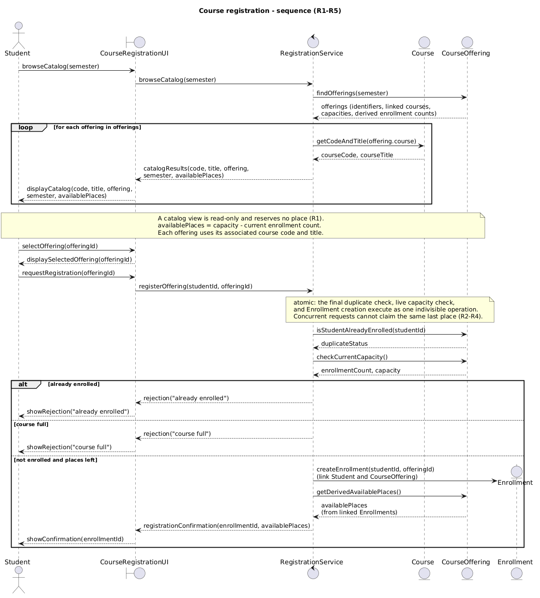
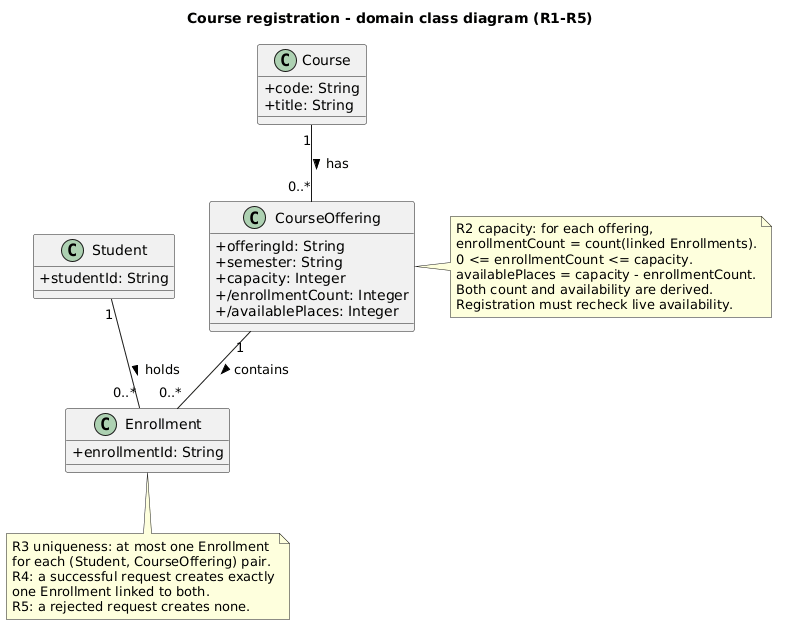
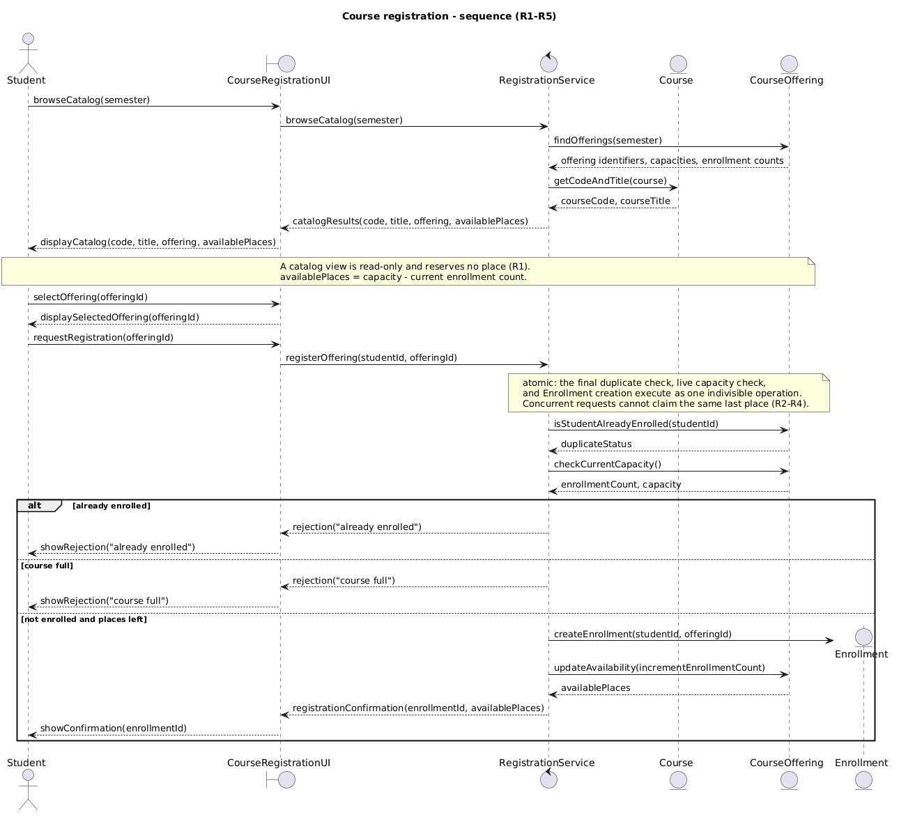

# SIS #02 — AI-Assisted UML Modeling: University Course Registration

<!--
  This is the only file you write your report in. README.md tells you what goes where.

  Rules the checker relies on:
  - Do not delete, rename or renumber the ## headings, the ### headings, or the **Label:** words.
  - Replace every "(write here)" and "(paste here)". None may be left when you submit.
  - Comments like this one are ignored by the checker and the word counter. Delete them or leave them.
-->


## 1. Scope and assumptions

**Scope:**
The system allows signed-in students to browse course offerings for a semester, view available places, register for a specific offering, and receive a confirmation or rejection. The system checks capacity and duplicate enrollments. Payments, prerequisites, timetable clashes, waiting lists, and cancellation are out of scope.

**Assumptions:**

1. Students are already signed in before requesting registration.
2. Available places are calculated using the offering capacity and current enrollment count.


## 2. User stories and acceptance criteria

<!-- Your APPROVED requirements: Prompt A's draft after your review. Keep the IDs, the three
     story headings and the bullet shape. Every criterion names the rule(s) it maps to,
     e.g. (R2, R4). Two criteria per story. Nothing out of scope.
     Format of a criterion, on one bullet:
     - **AC-03** (R2, R4): Given ..., When ..., Then ... -->

### US-01 — Browse offerings

**US-01:** As a student, I want to browse the course catalog for a selected semester so that I can see available course offerings and their remaining places.

- **AC-01** (R1): Given a semester contains course offerings with defined capacities and enrollment counts, When the student browses the catalog, Then the system displays the course code, title, offering, semester, and available places.
- **AC-02** (R1, R2): Given an offering has available places, When the student views the catalog without registering, Then no Enrollment is created, no place is reserved, and the enrollment count remains unchanged.

### US-02 — Register for an offering

**US-02:** As a student, I want to register for a specific course offering so that I can obtain a place when registration is permitted.

- **AC-03** (R2, R3, R4): Given an offering has available places and the student is not already enrolled, When the student requests registration, Then the system atomically rechecks capacity and duplicate enrollment, creates exactly one Enrollment linking the student and offering, updates availability, and returns a confirmation.
- **AC-04** (R2, R3, R4): Given an offering has capacity 2 and enrollment count 1, and the requesting student is not enrolled, When the student registers while the last place is available, Then the system atomically performs final checks, creates one Enrollment, increases the count to 2, updates available places to 0, and confirms registration.

### US-03 — Receive a clear rejection

**US-03:** As a student, I want to receive a clear rejection reason when registration is not permitted so that I understand why my request was unsuccessful.

- **AC-05** (R2, R5): Given the catalog previously showed an available place but the current offering is full and the student is not already enrolled, When the student requests registration, Then the system rejects the request with "course full", creates no Enrollment, and leaves the enrollment count unchanged.
- **AC-06** (R3, R5): Given the student already has an Enrollment for the selected offering, When the student requests registration again, Then the system rejects the request with "already enrolled", creates no additional Enrollment, and leaves the enrollment count unchanged.

## 3. Sequence diagram

<!-- The FINAL diagram, rendered. Change .png to .svg if that is what you exported. -->



**Participants:** (write here — each lifeline and what it stands for)

**Atomic operation:** (write here — which messages form the one atomic step: the final duplicate check, the capacity check and the creation of the Enrollment, and why a catalog view reserves nothing)

**Where the Enrollment is created:** (write here — which message, which lifeline, and which class in section 4 it produces)

**Technical lifelines:** (write here — every lifeline that is NOT a class in the class diagram, by name, and why the difference in abstraction is fine. "None" if there are none.)

## 4. Class diagram

<!-- The FINAL diagram, rendered. -->



<!-- One row per association in classes.puml, read in both directions. -->

| Association | Read left to right | Read right to left |
| --- | --- | --- |
| (write here) | (write here) | (write here) |
| (write here) | (write here) | (write here) |
| (write here) | (write here) | (write here) |

**How an Enrollment links a student to an offering:** (write here)

**Capacity constraint:** (write here — and why multiplicity alone cannot express it)

**Uniqueness constraint:** (write here — and why multiplicity alone cannot express it)

## 5. Traceability

<!-- Every rule, including the catalog fields and availability (R1). Column 1: the rule and
     the criteria that cover it, e.g. "R2 + AC-03, AC-04". Column 2: the message, guard,
     class or constraint that shows the rule in YOUR diagrams. Column 3: the T-ID that
     exercises it, or the extra check you did instead (R1 has no T case). -->

| Rule and criterion | Model evidence | Validation case |
| --- | --- | --- |
| R1 + (write here) | (write here) | (write here) |
| R2 + (write here) | (write here) | (write here) |
| R3 + (write here) | (write here) | (write here) |
| R4 + (write here) | (write here) | (write here) |
| R5 + (write here) | (write here) | (write here) |

## 6. Walkthroughs

<!-- Walk each case through YOUR final sequence diagram, message by message. Column 2: the
     actual steps and the state change (count before → after). Column 3 starts with Pass or
     Fail, then the location: the message, guard or note where you saw it. A Fail you
     report honestly is a finding, not a penalty. -->

| Case | Observed path and state change | Judgment and evidence |
| --- | --- | --- |
| T1. Available | (write here) | (write here) |
| T2. Last place | (write here) | (write here) |
| T3. Full | (write here) | (write here) |
| T4. Duplicate | (write here) | (write here) |

## 7. Review decisions

<!-- At least three substantive decisions about Prompt C's critique or your own inspection.
     Decision: accepted / rejected / modified — and what you did. Reason: why, in a full
     sentence. Rule: R1–R5. Do not invent an error to fill the table; a justified rejection
     of advice counts. -->

| AI suggestion or model element | Decision | Reason | Rule |
| --- | --- | --- | --- |
| (write here) | (write here) | (write here) | (write here) |
| (write here) | (write here) | (write here) | (write here) |
| (write here) | (write here) | (write here) | (write here) |

## 8. Modeling explanation

<!-- 200–300 words. Your main design choices; how the class diagram and the sequence diagram
     complement each other; why an activity diagram could also help explain the workflow. -->

(write here)

## 9. Reflection

<!-- 150–200 words. Written by you, not by the assistant: where AI helped, one decision you
     made yourself, one remaining limitation. Specific beats flattering. -->

(write here)

## 10. Appendix A — Before AI

<!-- Written BEFORE you run Prompt A, committed and pushed in your first commit, and never
     edited afterwards. This is what you paste into Prompt A as "My initial assumptions". -->

**Scope:** 
The system allows students to course catalog and available places,
select a specific course offering,
and receive registration confirmation or rejection.
The system checks available capacity and duplicate enrollment.


**Initial assumptions:**

1. I assume that students are already signed in 
   before requesting registration.

2. I assume that available places are calculated
   using offering capacity and current enrollment count.

## 11. Appendix B — AI exchanges

<!-- Complete prompts and complete responses, as text — never screenshots. Paste each inside
     the ~~~~ block that follows its label: AI responses contain ``` PlantUML blocks, and
     ~~~~ keeps them from breaking this file. Prompts B and C: the prompt text first, then
     the material it refers to ("below", "these two") pasted under it, in the same block.
     You may add B5, B6 … after B4 if you ran more. -->

### B1 — Requirements (Prompt A)

- **Tool:** ChatGpt
- **Model:** GPT-6
- **Date:** 2026-10-18
- **Purpose:** draft 3 user stories and 6 acceptance criteria

<!-- Model: the exact model with its version, as the tool shows it (e.g. "GPT-5 Thinking",
     "Claude Sonnet 4.5"). If the tool does not show it, write: not displayed
     Date: YYYY-MM-DD -->

**Prompt:**

~~~~text

Act as a requirements analyst. Use only this course registration scenario and rules R1–R5: A student browses an electronic course catalog, chooses a course offering and requests registration. Each offering has a limited number of places.

A Course describes a subject. A CourseOffering is one scheduled section in one semester. Registration always targets a specific offering.

Assume that the student is signed in, the selected offering exists, and its capacity is a positive whole number.

Exclude payments, prerequisites, timetable clashes, waiting lists and cancellation. Use fictional students and courses.

R1. Catalog: Show the course code, title, offering and available places for one semester.
R2. Capacity: Recheck current availability when registering. Enrollment must never exceed the offering's capacity.
R3. Duplicates: A student may have at most one enrollment in the same offering. Reject a repeat request.
R4. Success: Create exactly one Enrollment linking the student and offering, update availability and return a confirmation.
R5. Rejection: Explain "course full" or "already enrolled". Create no enrollment and leave the enrollment count unchanged.

A catalog view does not reserve a place. Model the final checks and enrollment creation as one atomic operation so competing requests cannot take the same last place. A note describing the atomic operation is sufficient; database implementation is outside this assignment.

My initial assumptions are 1. I assume that students are already signed in before requesting registration. 2. I assume that available places are calculated using offering capacity and current enrollment count.
Draft 3 user stories and 2 Given / When / Then acceptance criteria for each. Use IDs US-01 to US-03 and AC-01 to AC-06. Map each criterion to rule IDs.
Cover normal and rejection behavior. List uncertainty separately. Do not add excluded features or invent university policies.
~~~~

**Response:**

~~~~text

# Prompt A — Requirements Analysis

## 1. User Stories

### US-01 — View Course Catalog

**User Story:**  
As a student, I want to browse the course catalog for a selected semester so that I can see available course offerings and their remaining places.

**AC-01 — Display Course Catalog**

**Mapped Rules:** R1

- **Given** a semester contains course offerings with defined capacities and current enrollment counts,
- **When** the student browses the course catalog for that semester,
- **Then** the system displays each course code, course title, offering, semester, and number of available places.

**AC-02 — Browsing Does Not Reserve Places**

**Mapped Rules:** R1, R2

- **Given** a course offering has available places,
- **When** the student views the offering in the catalog without requesting registration,
- **Then** the system displays the current availability without creating an Enrollment, reserving a place, or changing the enrollment count.

---

### US-02 — Register for a Course Offering

**User Story:**  
As a student, I want to register for a specific course offering so that I can obtain a place in that offering when registration is permitted.

**AC-03 — Successful Registration**

**Mapped Rules:** R2, R3, R4

- **Given** a course offering has available places and the student is not already enrolled in that offering,
- **When** the student requests registration,
- **Then** the system atomically rechecks capacity and duplicate enrollment, creates exactly one Enrollment linking the student and offering, updates the available places, and returns a confirmation.

**AC-04 — Register for the Last Available Place**

**Mapped Rules:** R2, R3, R4

- **Given** a course offering has a capacity of 2, one existing enrollment, and the requesting student is not already enrolled,
- **When** the student requests registration while the last place remains available,
- **Then** the system performs the final checks and Enrollment creation atomically, creates exactly one Enrollment, increases the enrollment count to 2, updates the available places to 0, and returns a confirmation.

The atomic operation must prevent competing registration requests from exceeding the offering's capacity.

---

### US-03 — Receive Registration Rejection

**User Story:**  
As a student, I want to receive a clear rejection reason when registration is not permitted so that I can understand why my request was unsuccessful.

**AC-05 — Course Full Rejection**

**Mapped Rules:** R2, R5

- **Given** a student previously saw an available place in the catalog, but the offering's current enrollment count has reached its capacity and the student is not already enrolled,
- **When** the student requests registration,
- **Then** the system rechecks current availability, rejects the request with "course full", creates no Enrollment, and leaves the enrollment count unchanged.

**AC-06 — Duplicate Enrollment Rejection**

**Mapped Rules:** R3, R5

- **Given** a student already has an Enrollment for a specific course offering,
- **When** the same student requests registration for that offering again,
- **Then** the system rejects the request with "already enrolled", creates no additional Enrollment, and leaves the enrollment count unchanged.

---

## 2. Requirements Traceability

| Acceptance Criterion | Rule IDs | Expected behavior |
|---|---|---|
| AC-01 | R1 | Display catalog information and available places |
| AC-02 | R1, R2 | Browsing does not reserve capacity |
| AC-03 | R2, R3, R4 | Successful registration creates one Enrollment |
| AC-04 | R2, R3, R4 | Last available place is allocated atomically |
| AC-05 | R2, R5 | Full offering rejects registration without changes |
| AC-06 | R3, R5 | Duplicate registration is rejected without changes |

All five rules R1–R5 are covered by the six acceptance criteria.

## 3. Uncertainties

1. **Rejection priority:** If a student is already enrolled and the offering is also full, R3 and R5 do not explicitly state which rejection reason takes priority. The UML model can check duplicates first, consistent with the prescribed guarded sequence structure.

2. **Atomic implementation:** The scenario requires final checks and enrollment creation to be atomic but does not specify the technical mechanism. A UML note can represent this requirement without introducing database implementation details.

3. **Offering identification:** The scenario requires registration for a specific CourseOffering but does not define the format of its identifier. The class diagram may use a generic offering identifier as a modeling assumption.

## 4. Scope Verification

The proposed user stories and acceptance criteria cover catalog browsing, availability, successful registration, duplicate prevention, capacity enforcement, confirmation, and rejection.

No payments, prerequisites, timetable clashes, waiting lists, or cancellation features have been introduced.
~~~~

### B2 — UML drafts (Prompt B)

- **Tool:** (write here)
- **Model:** (write here)
- **Date:** (write here)
- **Purpose:** draft the sequence and class diagrams

**Prompt:**

~~~~text
Using my approved scenario, R1–R5, stories and criteria below, return separate PlantUML code blocks for a sequence diagram and a domain class diagram.
Sequence: include catalog browsing and guarded success, full-course and duplicate outcomes. Model final checks and creation as one atomic operation.
Class: show domain concepts, useful attributes and multiplicities. State the capacity and uniqueness constraints. Explain assumptions and any technical lifelines.

Approved scenario:
A signed-in student browses an electronic course catalog, selects a course offering in a semester, and requests registration. Each offering has a limited number of places. A Course describes a subject, and a CourseOffering is a scheduled section in one semester. Registration targets a specific offering. The selected offering exists and has positive capacity.

R1. Catalog: Show the course code, title, offering and available places for one semester.
R2. Capacity: Recheck current availability when registering. Enrollment must never exceed the offering's capacity.
R3. Duplicates: A student may have at most one enrollment in the same offering. Reject a repeat request.
R4. Success: Create exactly one Enrollment linking the student and offering, update availability and return a confirmation.
R5. Rejection: Explain "course full" or "already enrolled". Create no enrollment and leave the enrollment count unchanged.

Catalog browsing does not reserve a place. Final checks and enrollment creation must be atomic. Excluded features are payments, prerequisites, timetable clashes, waiting lists and cancellation.

Approved user stories and acceptance criteria:

US-01 — Browse offerings
As a student, I want to browse the course catalog for a selected semester so that I can see available course offerings and their remaining places.

AC-01 (R1): Given a semester contains course offerings with defined capacities and enrollment counts, When the student browses the catalog, Then the system displays the course code, title, offering, semester, and available places.

AC-02 (R1, R2): Given an offering has available places, When the student views the catalog without registering, Then no Enrollment is created, no place is reserved, and the enrollment count remains unchanged.

US-02 — Register for an offering
As a student, I want to register for a specific course offering so that I can obtain a place when registration is permitted.

AC-03 (R2, R3, R4): Given an offering has available places and the student is not already enrolled, When the student requests registration, Then the system atomically rechecks capacity and duplicate enrollment, creates exactly one Enrollment linking the student and offering, updates availability, and returns a confirmation.

AC-04 (R2, R3, R4): Given an offering has capacity 2 and enrollment count 1, and the requesting student is not enrolled, When the student registers while the last place is available, Then the system atomically performs final checks, creates one Enrollment, increases the count to 2, updates available places to 0, and confirms registration.

US-03 — Receive a clear rejection
As a student, I want to receive a clear rejection reason when registration is not permitted so that I understand why my request was unsuccessful.

AC-05 (R2, R5): Given the catalog previously showed an available place but the current offering is full and the student is not already enrolled, When the student requests registration, Then the system rejects the request with "course full", creates no Enrollment, and leaves the enrollment count unchanged.

AC-06 (R3, R5): Given the student already has an Enrollment for the selected offering, When the student requests registration again, Then the system rejects the request with "already enrolled", creates no additional Enrollment, and leaves the enrollment count unchanged.
~~~~

**Response:**

~~~~text
(paste here)
~~~~

### B3 — Model critique (Prompt C)

- **Tool:** (write here)
- **Model:** (write here)
- **Date:** (write here)
- **Purpose:** review both models against R1–R5 and T1–T4

**Prompt:**

~~~~text
(paste here)
~~~~

**Response:**

~~~~text
(paste here)
~~~~

### B4 — Focused revision (Prompt D)

- **Tool:** (write here)
- **Model:** (write here)
- **Date:** (write here)
- **Purpose:** apply my accepted review decisions

**Prompt:**

~~~~text
(paste here)
~~~~

**Response:**

~~~~text
(paste here)
~~~~

## 12. Appendix C — Original diagrams

<!-- The AI's first output from Prompt B, rendered unedited from models/original/. -->




## 13. Appendix D — References and source checks

### References

<!-- Full references, one per line, each starting with "- ". Only sources you actually opened.
     Every URL used in the source checks must also appear here. Example:
     - Sommerville, I. (2016). Software Engineering, 10th ed., Global Edition. Pearson. Ch. 5. -->

- (write here)

### Source checks

<!-- At least two modeling decisions you verified. Source and locator: title + slide, page,
     section, chapter or figure — or title + URL + access date (YYYY-MM-DD). Slide numbers
     refer to the decks posted in our Teams. -->

| Modeling decision | Source and locator | What the source says | How it supports or changed your model |
| --- | --- | --- | --- |
| (write here) | (write here) | (write here) | (write here) |
| (write here) | (write here) | (write here) | (write here) |
